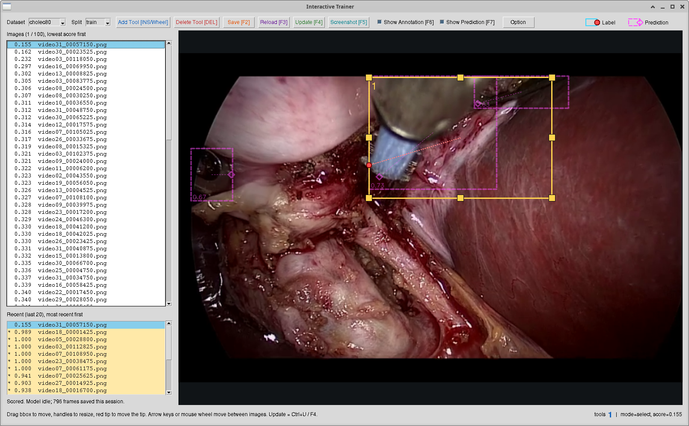

# Interactive Trainer 가이드

데이터셋 레이블 보정과 탐지 모델 미세조정(fine-tuning)을 한 루프에서 함께 진행하는 GUI 도구다. 모델의 예측과 현재 레이블이 가장 어긋나는 프레임부터 보여 주고, 사용자가 레이블을 고쳐 저장하면 모델이 그 프레임으로 백그라운드에서 곧바로 학습한다. 이 문서는 `scripts/interactive-trainer.py`의 사용자 설명서이자 상세 설계서다.



## 개요

### 왜 필요한가

`erop`·`cholec80` 데이터셋의 레이블은 성능이 낮은 모델로 자동 생성했기 때문에 품질이 낮고, 그 레이블로 학습한 탐지 모델도 성능이 낮다([final-report.md](final-report.md) §2.3). 레이블을 먼저 전부 고치고 나서 모델을 다시 학습하면 양쪽 모두 비용이 크다. 이 도구는 두 작업을 하나의 루프로 묶는다.

1. 모델이 레이블과 가장 다르게 예측하는 프레임을 먼저 보여 준다. 레이블이 틀렸거나 모델이 틀렸거나 둘 중 하나이므로, 사람이 확인할 가치가 가장 큰 프레임이다.
2. 사용자가 레이블을 고치거나 맞다고 확인해 저장하면, 모델이 그 프레임으로 즉시 학습한다.
3. 모델이 나아질수록 예측을 그대로 레이블의 출발점으로 쓸 수 있는 프레임이 늘어 수작업이 줄어든다.

### 다루는 모델

이 프로젝트의 히트맵 모델(`monai`·`monai_mini`)이 아니라, 도구 박스와 팁을 함께 내는 **YOLO 계열 탐지기**를 학습한다. 데이터셋 어노테이션이 도구마다 `bbox`와 `tip`을 함께 갖기 때문에, 예측을 그대로 어노테이션으로 바꿀 수 있는 모델이어야 하기 때문이다.

| 모델 계열                                              | 출력                                     | 예측 → 레이블 변환                                                                                   |
| ------------------------------------------------------ | ---------------------------------------- | ---------------------------------------------------------------------------------------------------- |
| `yolov8stooltip` (`standalone/yolov8stooltip`, 기본값) | `tool` 박스마다 팁 키포인트 1개          | 탐지 하나가 그대로 어노테이션 하나가 된다                                                            |
| `yolov8sclone` (`baseline/yolov8sclone`, `tooltip`)    | `tool` 박스와 `tip` 박스가 따로 나온다   | 후처리 규칙(`pair_detections`)으로 팁을 도구에 짝짓는다. 도구가 겹치면 다른 도구의 팁을 고를 수 있다 |

두 계열은 체크포인트에 `kpt_shape` 키가 있는지로 구분한다(있으면 `yolov8stooltip`).

## 실행

```bash
run interactive-trainer --device cuda:1          # Linux / macOS
run.bat interactive-trainer --device cuda:1      # Windows
```

### 사전 준비: 작업용 모델 사본

모델은 `data/itrainer-model/` 디렉터리의 `*.pt` 파일 중에서 고른다. 이 파일들은 학습할 때마다 **덮어쓰므로**, 각 모델 프로젝트의 학습 결과를 복사해 작업용 사본을 만든다.

```bash
mkdir -p data/itrainer-model
cp standalone/yolov8stooltip/data/model/cholec80/model.pt data/itrainer-model/yolov8stooltip.pt
cp baseline/yolov8sclone/data/model/cholec80/tooltip/model.pt data/itrainer-model/yolo8s.pt
```

다음 실행은 그때까지 학습된 사본에서 이어간다. 처음 상태로 되돌리려면 다시 복사한다.

## 인수

| 인수              | 기본값                                  | 설명                                                                   |
| ----------------- | --------------------------------------- | ---------------------------------------------------------------------- |
| `--dataset`       | `data/dataset/` 아래 첫 데이터셋        | 시작 데이터셋. GUI에서 바꿀 수 있다                                    |
| `--split`         | `train`                                 | 시작 스플릿(`train`·`val`·`test`). GUI에서 바꿀 수 있다                |
| `--model`         | `data/itrainer-model/yolov8stooltip.pt` | 시작 체크포인트. 같은 디렉터리의 다른 `*.pt`로 GUI에서 전환할 수 있다  |
| `--device`        | CUDA가 있으면 `cuda`, 없으면 `cpu`      | Torch 장치(예: `cuda:1`)                                               |
| `--initial-files` | 32                                      | 스플릿을 열 때 랜덤으로 뽑아 채점하는 프레임 수                        |
| `--new-files`     | 8                                       | 학습이 끝날 때마다 새로 뽑아 목록에 더하는 프레임 수                   |
| `--max-files`     | 100                                     | 목록의 최대 프레임 수. 넘으면 점수가 낮은 쪽만 남긴다                  |
| `--target-score`  | 0.9                                     | 저장한 프레임의 [일치 점수](#일치-점수)가 이 값에 이르면 학습을 멈춘다 |
| `--max-steps`     | 20                                      | 저장 한 번당 최대 학습 스텝 수                                         |
| `--replay`        | 3                                       | 매 스텝 배치에 함께 넣는 수작업 확인 프레임(`annotation-manual/`) 수   |
| `--lr`            | 1e-4                                    | AdamW 학습률                                                           |
| `--conf`          | 0.25                                    | 탐지 신뢰도 임계값                                                     |
| `--iou`           | 0.45                                    | NMS IoU 임계값                                                         |

`--model` 파일이 없거나 `data/dataset/` 아래 데이터셋이 하나도 없으면 GUI를 띄우지 않고 종료한다. `--initial-files`부터 `--iou`까지는 실행 중에 [Option 대화상자](#option-대화상자)에서 바꿀 수 있다.

## 화면 구성

```text
┌─────────────────────────────────────────────────────────────────────────────────────────┐
│ Dataset [▼] Split [▼] [Add Tool] [Delete Tool] [Save] [Reload] [Update] [Screenshot]    │  ← 툴바
│ ☑ Show Annotation  ☑ Show Prediction  [Option]                 범례: Label  Prediction  │
├──────────────────────────┬──────────────────────────────────────────────────────────────┤
│ Images (k / N), lowest…  │                                                              │
│ ┌──────────────────────┐ │                                                              │
│ │ 0.155  video31_…png  │ │                                                              │
│ │ 0.162  video30_…png  │ │                  편집 캔버스                                 │
│ │ …  (점수 낮은 순)    │ │   레이블: 실선 박스 + 빨간 팁 (편집 가능)                    │
│ └──────────────────────┘ │   예측:  50 % 투명 자홍색 점선 박스 + 마름모 팁 + 신뢰도     │
│ Recent (last 20), …      │                                                              │
│ ┌──────────────────────┐ │                                                              │
│ │ * 0.989 video18_…png │ │                                                              │
│ └──────────────────────┘ │                                                              │
│ 모델 상태 줄             │                                                              │
├──────────────────────────┴──────────────────────────────────────────────────────────────┤
│ 조작 안내                                         tools 1 | mode=select, score=0.155    │  ← 상태 바
└────────────────────────────────────────────────────────────────────────────────────    ─┘
```

### 툴바

| 요소                   | 설명                                                                                        |
| ---------------------- | ------------------------------------------------------------------------------------------- |
| `Dataset`, `Split`     | 작업할 데이터셋과 스플릿. 바꾸면 목록을 버리고 새로 뽑는다                                  |
| `Add Tool [INS/Wheel]` | 도구 추가 모드. 누른 상태에서는 `Adding... (Esc/Wheel to cancel)`로 바뀌고 노란 배경이 된다 |
| `Delete Tool [DEL]`    | 선택한 도구 삭제. 선택한 도구가 없으면 비활성                                               |
| `Save [F2]`            | 레이블 저장 후 백그라운드 학습 시작                                                         |
| `Reload [F3]`          | 편집 내용을 버리고 파일의 레이블을 다시 읽음                                                |
| `Update [F4]`          | 편집 중인 레이블을 모델 예측으로 교체 (저장 전)                                             |
| `Screenshot [F5]`      | 보이는 오버레이를 원본 해상도로 그려 저장                                                   |
| `Show Annotation [F6]` | 레이블 오버레이 표시 전환. 끄면 캔버스에서 레이블을 고를 수도 없다                          |
| `Show Prediction [F7]` | 예측 오버레이 표시 전환                                                                     |
| `Option`               | [Option 대화상자](#option-대화상자) 열기                                                    |
| 범례                   | 레이블(하늘색 실선 박스, 빨간 팁)과 예측(자홍색 점선 박스, 마름모 팁)의 모양                |

### 왼쪽 패널

- **점수 순 목록**(위): 목록의 프레임을 [일치 점수](#일치-점수)가 낮은 순으로 보여 준다. 각 행은 `[*] 점수  파일명`이다. 제목 줄 `Images (k / N), lowest score first`의 `k`는 지금 편집 중인 프레임의 순위, `N`은 목록 크기다.
- **최근 목록**(아래): 현재 데이터셋·스플릿에서 화면에 연 프레임 20개를 최근 순으로 보여 준다. 점수가 밀려 위 목록에서 빠진 프레임도 여기서 다시 열어 똑같이 편집·저장할 수 있다. 아직 채점되지 않은 프레임은 점수 자리에 `-`가 표시된다. 위 목록과 함께 다시 채점되며, 프로그램을 끄면 사라진다.
- **모델 상태 줄**(맨 아래): 불러온 모델(`파일명 [계열] (데이터셋, epoch, 누적 학습 라운드 수) on 장치`), 채점 진행률, 학습 진행률(`step s / max, score x (target y)`), 오류를 표시한다.

두 목록의 행 색:

| 행                                 | 배경             | 표시                                 |
| ---------------------------------- | ---------------- | ------------------------------------ |
| 지금 편집 중인 프레임              | 하늘색 `#87ceeb` | 수작업 여부와 관계없이 하늘색이 우선 |
| `annotation-manual/`에 있는 프레임 | 노란색 `#ffe9a8` | 파일명 앞 `*`                        |
| 그 밖                              | 기본             |                                      |

### 편집 캔버스

- 프레임을 창 크기에 맞게 비율을 유지해 축소·확대해 그린다.
- **레이블**: 도구마다 하늘색 실선 박스(선택하면 노란색 굵은 박스와 리사이즈 핸들 8개), 왼쪽 위의 도구 번호, 박스 중심에서 팁까지의 분홍 점선, 빨간 팁 원.
- **예측**: 도구마다 자홍색 점선 박스, 박스 중심에서 팁까지의 가는 점선, 마름모 팁, 박스 왼쪽 아래의 신뢰도. Tk 캔버스 도형은 반투명이 안 되므로 예측은 표시용 이미지에 직접 그려 50 % 불투명도로 섞는다.
- 추가 모드에서는 이미지를 50 % 밝기로 어둡게 하고, 드래그 중인 새 박스 안만 원래 밝기로 보여 준다.
- 팁이나 리사이즈 핸들 위에 포인터가 오면 커서가 십자로 바뀌고 해당 핸들이 흰색으로 강조된다.

### 상태 바

왼쪽은 조작 안내, 오른쪽은 현재 레이블의 도구 수(파란 굵은 숫자)와 상태 메시지다. 평소에는 `mode=select, score=0.155[, edited]` 형식으로 모드, 현재 프레임의 일치 점수, 저장하지 않은 편집 여부를 보여 준다.

## 작업 흐름

1. **목록 생성.** 스플릿을 열면 `annotation-manual/`에 없는 프레임 중 32개(`--initial-files`)를 랜덤으로 뽑아 모델로 추론하고 채점한다. 채점이 끝나면 목록이 점수 낮은 순으로 채워지고 첫 프레임이 열린다. `annotation-manual/`에 있는 프레임은 사람이 이미 확인한 것이므로 뽑지 않는다.
2. **편집.** 레이블을 직접 고치거나, `Update`로 모델 예측을 불러와 그것부터 고친다.
3. **저장.** `Save`를 누르면 레이블을 `annotation-manual/`에 쓰고 `annotation/`에 복사한다. 그리고 **목록이 이미 가진 점수**로 현재 프레임을 뺀 나머지 중 점수가 가장 낮은 프레임을 곧바로 연다. 레이블을 고치지 않았어도 저장할 수 있다. "레이블이 맞고 모델이 틀렸다"는 확인도 고친 레이블만큼 유용한 학습 신호이기 때문이다.
4. **백그라운드 학습.** 저장한 프레임으로 모델이 학습한다. 매 스텝 배치에 `annotation-manual/`의 다른 프레임 3장(`--replay`)을 함께 넣어 다른 장면을 잊지 않게 한다. 저장한 프레임의 점수가 0.9(`--target-score`)에 이르거나 20스텝(`--max-steps`)이 되면 멈추고 체크포인트를 덮어쓴다.
5. **재채점.** 학습이 끝나면 목록의 프레임 전체와 새로 뽑은 8개(`--new-files`), 최근 목록에만 있는 프레임을 새 모델로 다시 채점해 목록을 갱신한다. 목록은 학습할 때마다 8개씩 늘고, 100개(`--max-files`)를 넘으면 점수가 낮은 100개만 남긴다.

추론과 학습은 백그라운드 스레드 하나에서 차례로 실행되므로, 사용자는 학습이나 재채점을 기다리지 않고 바로 다음 프레임을 편집한다. 그 대가는 두 가지다.

- 저장 직후 열리는 다음 프레임은 갱신된 모델의 점수가 아니라 **저장할 때 목록에 있던 점수**로 정해진다.
- 목록이 백그라운드에서 갱신되면 편집 중인 프레임이 더 이상 첫 번째가 아닐 수 있다. 편집 중인 프레임은 하늘색으로 표시되므로 위치가 바뀌어도 찾을 수 있다.

학습 중에 또 저장하면 학습이 순서대로 쌓이고, 목록 재채점은 마지막 학습이 끝난 뒤 한 번만 한다. 저장한 프레임은 목록에서 빠지지 않고 그대로 남아 다시 채점되며, 보통은 점수가 올라 목록 아래쪽으로 내려가다가 `--max-files`를 넘으면 밀려난다.

## 조작 방법

### 키보드·마우스

| 조작                                   | 동작                                              |
| -------------------------------------- | ------------------------------------------------- |
| `Insert`, 캔버스 휠 클릭               | 도구 추가 모드 진입. 추가 모드에서 휠 클릭은 취소 |
| `Esc`                                  | 도구 추가 모드 취소                               |
| `Delete`                               | 선택한 도구 삭제                                  |
| `Ctrl+S`, `F2`                         | 저장 후 학습                                      |
| `F3`                                   | 파일에서 레이블 다시 읽기                         |
| `Ctrl+U`, `F4`                         | 레이블을 모델 예측으로 교체                       |
| `F5`                                   | 스크린샷 저장                                     |
| `F6` / `F7`                            | 레이블 / 예측 오버레이 표시 전환                  |
| `↑` `←` / `↓` `→`, 마우스 휠 위 / 아래 | 점수 순 목록의 이전 / 다음 프레임                 |
| 목록 행 클릭                           | 그 프레임 열기 (점수 순 목록·최근 목록 모두)      |

`D` 같은 글자 키는 일부러 바인딩하지 않았다. 다른 곳에 입력하려던 글자 하나가 도구를 지우는 일을 막기 위해서다.

### 레이블 편집 (annotation_editor와 같은 방식)

| 대상          | 조작                   | 결과                                                                                                                     |
| ------------- | ---------------------- | ------------------------------------------------------------------------------------------------------------------------ |
| 빨간 팁       | 드래그                 | 팁 이동. 팁이 박스 밖으로 나가면 박스가 팁을 포함하도록 늘어나고, 다시 안으로 들이면 원래 크기로 돌아온다                |
| 박스 내부     | 드래그                 | 박스와 팁을 함께 평행 이동. 이미지 밖으로는 나가지 않는다                                                                |
| 리사이즈 핸들 | 드래그 (선택한 박스만) | 모서리 핸들은 두 좌표, 변 핸들은 한 좌표만 움직인다. 박스가 줄어 팁이 밖에 놓이면 팁을 박스 안 가장 가까운 화소로 당긴다 |
| 빈 곳         | 클릭                   | 선택 해제                                                                                                                |
| 추가 모드     | 드래그                 | 새 박스 생성. 가로·세로가 모두 4 px 이상일 때만 만들어지며, 팁은 박스 중심에 놓인다                                      |

클릭 판정 순서는 **팁 → 선택한 박스의 리사이즈 핸들 → 박스 내부** 다. 팁이 여럿 겹치면 가장 가까운 팁(동률이면 선택한 도구)을, 박스가 겹치면 **가장 작은 박스**를 고른다. 큰 박스 안에 들어 있는 작은 도구도 선택할 수 있게 하기 위해서다. 팁과 핸들의 판정 반경은 화면 기준 12 px(이미지 좌표로 최소 3 px)이고, 박스는 테두리 안쪽을 눌러야 잡힌다.

방향키와 마우스 휠은 점수 순 목록 안에서만 움직인다. 최근 목록에서 연 프레임이 점수 순 목록에 없으면 방향키로는 이동하지 않으므로, 목록 행을 클릭해 옮긴다.

### 저장하지 않은 편집

편집한 뒤 다른 프레임·데이터셋·스플릿으로 옮기려 하면 `Save changes (and train on them) before leaving this image?`를 묻는다.

| 응답     | 동작                                    |
| -------- | --------------------------------------- |
| `Yes`    | 저장하고 학습을 큐에 넣은 뒤 이동       |
| `No`     | 편집을 버리고 이동                      |
| `Cancel` | 이동하지 않고 편집 중인 프레임에 머문다 |

창을 닫을 때도 같은 질문을 하고, 그다음 학습이 남아 있으면 종료를 한 번 더 확인한다.

### 스크린샷

`Screenshot`은 현재 프레임에 **보이는 오버레이만**(Show Annotation / Show Prediction 상태를 따름) 원본 해상도로 그려 `data/dataset/<데이터셋>/screenshot/<프레임 파일명>`에 저장한다. annotation_editor와 같은 위치이며, 같은 프레임을 다시 찍으면 덮어쓴다. 선택 강조, 리사이즈 핸들, 추가 모드의 미리보기 박스 같은 편집 보조 표시는 그리지 않는다.

## Option 대화상자

툴바의 `Option` 버튼으로 연다. 모델과 수치값을 한 화면에서 고친다.

| 항목                             | 대응 인수         | 허용 범위              | 바꾼 뒤                  |
| -------------------------------- | ----------------- | ---------------------- | ------------------------ |
| Model                            | `--model`         | 같은 디렉터리의 `*.pt` | 즉시 모델 전환 후 재채점 |
| Frames drawn when a split opens  | `--initial-files` | 1 이상                 | 다음 스플릿부터          |
| Frames added after each training | `--new-files`     | 0 이상                 | 다음 학습부터            |
| Most frames in the list          | `--max-files`     | 1 이상                 | 즉시 재채점              |
| Training target score            | `--target-score`  | 0〜1                   | 다음 학습부터            |
| Most training steps per save     | `--max-steps`     | 1 이상                 | 다음 학습부터            |
| Replayed frames per step         | `--replay`        | 0 이상                 | 다음 학습부터            |
| Learning rate (AdamW)            | `--lr`            | 1e-8〜1                | 다음 학습부터            |
| Detection confidence threshold   | `--conf`          | 0〜1                   | 즉시 재채점              |
| NMS IoU threshold                | `--iou`           | 0〜1                   | 즉시 재채점              |

- `OK`(Enter)를 누르면 **모든 값을 먼저 검사**한 뒤 한꺼번에 적용한다. 하나라도 범위를 벗어나거나 숫자가 아니면 오류를 띄우고 아무것도 바꾸지 않는다. 정수 항목에 `3.0`처럼 정수 값을 쓴 실수는 받아들인다.
- `Cancel`(Esc)은 아무것도 바꾸지 않는다.
- 바꾼 값은 이번 실행 동안만 유지된다. 다음 실행은 다시 명령행 인자에서 시작한다.
- 편집 중인 프레임과 편집 내용은 어떤 값을 바꿔도 그대로 남는다.

### 모델 전환

모델 목록은 대화상자를 열 때마다 디렉터리를 다시 읽는다. 다른 모델을 고르면:

1. 백그라운드 스레드가 새 체크포인트를 불러온다. 이미 큐에 쌓인 학습은 **이전 모델로 끝까지 학습하고 이전 모델 파일에 저장된다.** 작업이 큐 순서대로 실행되기 때문이다.
2. 목록 전체를 새 모델로 다시 채점한다. 아직 첫 목록을 채점하던 중이었다면 그 결과를 버리고 새 모델로 처음부터 다시 뽑는다.
3. 불러오기에 실패하면 오류를 띄우고 원래 모델로 돌아간다.

## 일치 점수

목록의 정렬 기준이자 학습 종료 조건이다. 한 프레임의 **모델 예측**과 **현재 레이블**이 얼마나 일치하는지를 0〜1로 나타낸다(`agreement_score`).

### 계산식

예측 도구 집합을 $P = \{p_1, \dots, p_m\}$, 레이블 도구 집합을 $L = \{l_1, \dots, l_n\}$이라 하자. 각 도구는 박스 $B$와 팁 좌표 $t$를 갖는다.

**1단계: 쌍별 품질.** 모든 (예측, 레이블) 쌍에 대해 박스 IoU와 팁 근접도를 반씩 더한다.

$$
q_{ij} = \frac{1}{2}\,\mathrm{IoU}(B_{p_i}, B_{l_j}) + \frac{1}{2}\,\max\!\left(0,\ 1 - \frac{\lVert t_{p_i} - t_{l_j} \rVert_2}{D}\right), \qquad D = 32\ \text{px}
$$

- $\mathrm{IoU}$는 정수 화소 박스의 교집합 넓이를 합집합 넓이로 나눈 값이다.
- 팁 근접도는 팁 거리가 0이면 1, $D/2 = 16$ px이면 0.5이고, $D = 32$ px 이상이면 0이다. $D$는 `yolov8sclone`이 학습에 쓰는 팁 박스의 한 변 길이(`TIP_DISTANCE_SCALE`)다.
- 따라서 $0 \le q_{ij} \le 1$이다.

**2단계: 일대일 배정.** 헝가리안 알고리즘(`scipy.optimize.linear_sum_assignment`)으로 $q$의 합이 최대가 되는 일대일 배정 $M$을 찾는다. $m \ne n$이면 $\min(m, n)$개의 쌍만 만들어진다.

**3단계: 정규화.** 배정된 쌍의 품질 합을 **두 집합 중 큰 쪽의 크기**로 나눈다.

$$
S(P, L) =
\begin{cases}
1 & m = 0,\ n = 0 \\[2pt]
0 & m = 0 \text{ 또는 } n = 0 \text{ (한쪽만 빔)} \\[2pt]
\dfrac{1}{\max(m, n)} \displaystyle\max_{M} \sum_{(i, j) \in M} q_{ij} & \text{그 밖}
\end{cases}
$$

짝을 찾지 못한 도구(놓친 도구 또는 더 찾은 도구)는 분자에 아무것도 더하지 않고 분모만 키우므로, **완전히 틀린 도구 하나와 같은 만큼 감점**된다.

### 계산 예

| 상황                                          | 계산                                   |  점수 |
| --------------------------------------------- | -------------------------------------- | ----: |
| 도구 1개, 박스 IoU 1.0, 팁 거리 0 px          | $0.5 \cdot 1 + 0.5 \cdot 1$            | 1.000 |
| 도구 1개, 박스 IoU 0.8, 팁 거리 8 px          | $0.5 \cdot 0.8 + 0.5 \cdot (1 - 8/32)$ | 0.775 |
| 도구 1개, 박스 IoU 1.0, 팁 거리 40 px         | $0.5 \cdot 1 + 0.5 \cdot 0$            | 0.500 |
| 레이블 2개, 예측 1개(그중 하나와 완벽히 일치) | $(1 + 0) / 2$                          | 0.500 |
| 레이블 1개, 예측 3개(그중 하나와 완벽히 일치) | $(1 + 0 + 0) / 3$                      | 0.333 |
| 레이블 0개, 예측 1개                          | 한쪽만 빔                              | 0.000 |
| 레이블 0개, 예측 0개                          | 둘 다 빔                               | 1.000 |

위 화면 예시의 첫 프레임(0.155)은 레이블이 도구 1개, 예측이 도구 3개인 경우다. 예측 셋 중 가장 잘 맞는 하나의 품질이 0.465 정도여도 3으로 나누면 0.155가 된다.

### 해석

- **목표 점수 0.9의 의미.** 도구가 1개인 프레임에서 $S \ge 0.9$이려면 $\mathrm{IoU} + \text{근접도} \ge 1.8$이어야 한다. 박스가 완벽해도($\mathrm{IoU} = 1$) 팁 거리가 6.4 px 이내여야 하고, $\mathrm{IoU} = 0.9$이면 팁 거리가 0 px여야 한다.
- **도구 수가 틀리면 목표에 닿을 수 없다.** 레이블 도구가 $n$개인데 예측이 $n-1$개이면 점수 상한은 $(n-1)/n$이다(도구 3개면 0.667). 이 경우 학습은 `--max-steps`까지 돈다.
- **점수가 낮다는 것은 "어긋난다"는 뜻일 뿐이다.** 레이블이 틀렸는지 모델이 틀렸는지는 알려 주지 않는다. 그 판단이 사람의 몫이다.
- **사각지대.** 예측과 레이블이 모두 비어 있으면 1점이므로, 레이블과 모델이 같은 도구를 함께 놓친 프레임은 이 점수로 찾을 수 없다. 둘 다 같은 위치를 똑같이 틀리게 잡은 경우도 마찬가지다.
- **평가 지표가 아니다.** 이 점수는 목록 정렬과 학습 종료 판정용이다. 모델 성능은 각 모델 프로젝트의 평가(`eval-model`)로 따로 확인한다([주의 사항](#주의-사항)).

## 설계 상세

### 스레드 구조

Tk는 스레드 안전하지 않고, 모델은 두 스레드가 동시에 만지면 안 된다. 그래서 **모든 모델 호출(불러오기·채점·학습)은 백그라운드 스레드 하나(`ModelWorker`)에서 큐 순서대로** 실행하고, GUI 스레드는 100 ms마다 이벤트 큐를 읽어 위젯을 갱신한다(`_poll_events`). GUI는 GPU를 기다리지 않는다.

```text
GUI 스레드 (tkinter)                         ModelWorker 스레드
───────────────────                          ──────────────────
_load_split / _request_scores ── jobs ──▶   ("score", generation, items, recent)
_save_current_annotation      ── jobs ──▶   ("train", image, annotations, replay)
_switch_model                 ── jobs ──▶   ("load", model path)

_poll_events (100 ms)         ◀── events ── ("ready" | "load-failed" | "error",
                                              "score-progress" | "scored",
                                              "train-progress" | "trained", ...)
```

| 작업 (`jobs`)                           | 내용                                                                        |
| --------------------------------------- | --------------------------------------------------------------------------- |
| `("load", path)`                        | 체크포인트를 연다. 실패하면 `load-failed`를 보내고 이전 모델을 유지한다     |
| `("score", generation, items, recent)`  | 각 프레임을 추론·채점한다. `recent`는 순위에 넣지 않고 최근 목록만 갱신한다 |
| `("train", image, annotations, replay)` | 저장한 프레임으로 학습하고 체크포인트를 덮어쓴다                            |

| 이벤트 (`events`)           | GUI의 처리                                                  |
| --------------------------- | ----------------------------------------------------------- |
| `ready`                     | 모델 상태 줄 갱신, 실제로 불러온 모델 이름 기록             |
| `load-failed`               | 오류 대화상자, 선택 모델을 실제로 불러온 모델로 되돌림      |
| `error`                     | 오류 대화상자. 작업 하나의 실패가 스레드를 죽이지 않는다    |
| `score-progress`, `scored`  | 진행률 표시, 목록 갱신 (`generation`이 현재 값과 같을 때만) |
| `train-progress`, `trained` | 진행률 표시, 대기 학습 수 감소, 마지막 학습이면 재채점 요청 |

**세대 번호(`generation`).** 데이터셋·스플릿을 바꿀 때마다 1씩 올린다. 이전 스플릿에 대해 요청한 채점 결과가 늦게 도착하면 세대 번호가 달라 버린다.

### 목록 관리

**뽑기(`_request_scores`).** 채점 요청에는 세 종류의 프레임이 들어간다.

1. 지금 목록에 있는 프레임 전부
2. 스플릿에서 새로 뽑은 프레임 `k`개. 목록에 이미 있거나 `annotation-manual/`에 있는 프레임은 후보에서 뺀다. `k`는 스플릿을 열 때 `--initial-files`, 학습 뒤 `--new-files`, 설정·모델만 바뀌었을 때 0이다.
3. 최근 목록에만 있는 프레임 (1·2에 없는 것)

**정렬과 상한(`_apply_scores`).**

1. 1·2의 결과를 점수 오름차순으로 정렬하고 앞에서 `--max-files`개만 남긴다.
2. 편집 중인 프레임이 잘렸으면 다시 넣는다. 사용자가 작업 중인 프레임이 목록에서 사라지지 않게 하기 위해서다.
3. `annotation-manual/` 목록을 디스크에서 다시 읽는다. 그사이 annotation_editor 같은 다른 도구로 고친 프레임도 노란색으로 표시되고, 이후 새로 뽑히지 않는다.
4. 처음 만든 목록이면(편집 중인 프레임이 없으면) 첫 프레임을 연다. 그 밖에는 편집 중인 프레임을 그대로 두고 선택 표시만 옮긴다.

**학습 뒤 재채점 시점(`_on_trained`).** 대기 중인 학습 수(`pending_trains`)가 0이 될 때만 재채점한다. 곧 다시 바뀔 모델로 여러 번 채점하지 않기 위해서다.

**저장 후 다음 프레임.** 목록은 점수 오름차순이므로, 현재 프레임이 아닌 첫 행이 남은 프레임 중 점수가 가장 낮은 것이다. 다른 프레임이 없으면 현재 프레임에 머문다.

### 저장 파일

`Save`는 tooltip-annotator의 annotation_editor와 같은 형식, 같은 위치에 쓴다. 따라서 annotation_editor와 `generate_annotation`이 이 파일을 자기가 쓴 수작업 레이블로 읽는다.

| 경로                                                               | 내용                                |
| ------------------------------------------------------------------ | ----------------------------------- |
| `data/dataset/<데이터셋>/annotation-manual/<스플릿>/<프레임>.json` | 수작업 레이블 원본                  |
| `data/dataset/<데이터셋>/annotation/<스플릿>/<프레임>.json`        | 위 파일을 바이트 그대로 복사한 사본 |

파일 내용의 예(키는 알파벳 순으로 정렬해 쓴다, 수치는 예시):

```json
{
  "annotations": [
    {"bbox": {"height": 282, "width": 428, "x": 430, "y": 90}, "tip": {"x": 431, "y": 210}}
  ],
  "edited_at": "2026-11-06T16:04:00+09:00",
  "height": 480,
  "image": "video31_00057150.png",
  "source": "manual",
  "width": 736
}
```

레이블을 읽을 때(`read_annotations`)는 파일이 없거나 깨졌으면 빈 레이블로, 항목 하나가 깨졌으면 그 항목만 건너뛴다. 박스 너비·높이는 최소 1 px로 맞춘다.

### 예측을 레이블로 바꾸기

모델 출력은 원본 프레임 좌표로 되돌린 뒤(letterbox 역변환) 어노테이션 형식으로 바꾼다. 두 계열 공통으로 `tool_annotation`이 팁을 프레임 안으로 자르고, **박스가 팁 화소를 포함하도록 늘린다**(annotation_editor에서 팁을 박스 밖으로 끌었을 때와 같은 규칙). 결과는 박스 왼쪽 위 좌표 순으로 정렬한다.

**`yolov8stooltip`(`pose_annotations`).** 출력 행 `[x1, y1, x2, y2, score, class, kx, ky]`가 도구 박스와 그 팁을 이미 짝지어 갖고 있으므로 행 하나가 어노테이션 하나가 된다.

**`yolov8sclone`(`pair_detections`).** `tool` 박스와 `tip` 박스가 따로 나오므로 짝을 지어야 한다.

1. `tip` 박스의 중심을 팁 좌표로 쓴다.
2. 팁이 `tool` 박스를 사방으로 16 px(`PAIR_MARGIN`) 늘린 영역 안에 있을 때만 그 도구와 짝지을 수 있다. 팁 박스는 팁을 중심으로 하므로, 박스 가장자리의 팁이 살짝 밖에 찍힐 수 있기 때문이다.
3. 짝지을 수 있는 쌍 중에서 **팁 신뢰도 합이 최대**가 되는 일대일 배정을 헝가리안 알고리즘으로 고른다.
4. 팁을 받지 못한 도구는 **박스 꼭짓점 중 이미지 중심에 가장 가까운 것**을 팁으로 삼는다. 도구는 프레임 가장자리에서 들어오므로 끝이 중심 쪽을 향한다는 가정이다.
5. 도구를 찾지 못한 팁은 버린다. 어노테이션은 박스와 팁이 모두 있어야 하기 때문이다.

### 학습 루프 (`ModelRunner.train`)

```text
before = score = S(predict(frame), label)
steps = 0
while score < target_score and steps < max_steps:
    batch = [저장한 프레임] + annotation-manual/의 다른 프레임 min(replay, 가용 수)장 (스텝마다 새로 랜덤 추출)
    각 프레임: letterbox → 50 % 확률 좌우 반전 → HSV 색 지터
    model.train(); 모든 BatchNorm2d는 eval 유지
    loss = criterion(model(images), targets)
    AdamW 한 스텝 (gradient norm 10으로 clip)
    steps += 1
    score = S(predict(frame), label)          # 저장한 프레임만으로 종료 판정
if steps > 0:
    체크포인트 저장
```

- **BatchNorm 고정.** 배치가 4장 남짓이라 BatchNorm 통계가 쓸모없으므로, 학습 모드에서도 BatchNorm 층은 eval 상태로 두어 원래 학습이 남긴 running 평균·분산을 유지한다.
- **추론 최적화 미사용.** 각 프로젝트의 추론 클래스는 BatchNorm을 합성곱에 접어 넣어(fuse) 더 이상 학습할 수 없으므로, 여기서는 체크포인트에서 모델을 직접 만든다.
- **학습 타겟 형식.** 행마다 `[이미지 번호, 클래스, ...]`이고 좌표·크기는 입력 크기(체크포인트의 `image_size`, 기본 640)로 정규화한다.

| 계열             | 어노테이션 하나당 타겟 행                                                                | 손실                                  |
| ---------------- | ---------------------------------------------------------------------------------------- | ------------------------------------- |
| `yolov8stooltip` | `[0, cx, cy, w, h, kx, ky, 1]` 한 행 (도구 박스 + 팁 키포인트, 가시성 1)                 | `PoseLoss` (체크포인트의 `kpt_sigma`) |
| `yolov8sclone`   | `[tool, cx, cy, w, h]`와 `[tip, tx, ty, s, s]` 두 행 (`s` = 체크포인트의 `tip_box_size`) | `DetectionLoss`                       |

- **옵티마이저 상태.** AdamW는 모델을 불러올 때 한 번 만들고 그 모델을 쓰는 동안 모멘트를 유지한다. 학습률은 매 학습 시작 시 현재 `--lr`로 다시 맞춘다. 모델을 전환하면 새 옵티마이저로 시작한다.
- **학습이 0스텝인 경우.** 저장한 프레임이 이미 목표 점수 이상이면 학습하지 않고 체크포인트도 쓰지 않는다.

### 체크포인트 저장 (`ModelRunner._save`)

- 가중치(`model`)를 뺀 나머지 키는 **불러온 그대로** 다시 쓴다. 그래서 각 모델 프로젝트의 `eval-model`이 이 체크포인트를 그대로 열 수 있다.
- `itrain_rounds` 키를 1 늘린다. 모델 상태 줄의 `n rounds`가 이 값이다.
- `<파일>.pt.tmp`에 먼저 쓴 뒤 `os.replace`로 교체한다. 쓰는 도중에 창을 닫거나 프로세스가 죽어도 잘린 체크포인트가 남지 않는다.

### 두 모델 프로젝트를 한 프로세스에 올리기

`baseline/yolov8sclone`과 `standalone/yolov8stooltip`은 둘 다 패키지 이름이 `common`이다. `import_common`은 각 `common/`을 `clone_common`·`pose_common`이라는 별칭 패키지로 불러와 이름 충돌 없이 한 프로세스에 함께 올린다. 패키지 안의 상대 import는 별칭 안에서 풀린다. letterbox와 그 역변환, 데이터셋 목록(`available_datasets`), 색 지터는 `clone_common`의 것을 두 계열이 함께 쓴다. 디코딩·NMS·키포인트 역변환·손실은 계열마다 자기 패키지의 것을 쓴다.

### 클래스 구조

```text
scripts/interactive-trainer.py
├── import_common(alias, dir)         모델 프로젝트의 common/을 별칭 패키지로 import
├── read_annotations / write_manual_annotation   어노테이션 JSON 읽기 / 수작업 형식으로 쓰기
├── pair_detections(...)              yolov8sclone: tool·tip 박스 → 어노테이션 (짝짓기)
├── pose_annotations(...)             yolov8stooltip: 키포인트 탐지 → 어노테이션
├── tool_annotation(...)              예측 도구 하나 → 어노테이션 (팁 클립, 박스 확장)
├── agreement_score(pred, label)      일치 점수 (헝가리안 배정)
├── ModelRunner                       체크포인트 하나: 추론·학습·저장 공통부
│   ├── open(path, device, args)       kpt_shape 유무로 하위 클래스 선택
│   ├── train(frame, labels, replay, report)   목표 점수 또는 최대 스텝까지 학습
│   ├── _training_batch(batch)         letterbox·반전·색 지터, 타겟 행 정규화
│   └── _save()                        임시 파일 경유 덮어쓰기, itrain_rounds += 1
│   ├── DetectorRunner (yolov8sclone)  _build / predict / _label_rows
│   └── PoseRunner (yolov8stooltip)    _build / predict / _label_rows
├── ModelWorker (threading.Thread)    모든 모델 호출을 큐 순서대로 실행
│   └── run() → _load / _score / _train
└── InteractiveTrainer                GUI
    ├── _build_ui / _bind_events       위젯과 단축키
    ├── _poll_events                   워커 이벤트 → 위젯 갱신 (100 ms 주기)
    ├── _load_split                    목록 초기화 후 --initial-files개 채점 요청
    ├── _request_scores(new_count)     목록 + 새 프레임 + 최근 프레임 채점 요청
    ├── _apply_scores                  정렬·상한 적용, 편집 중 프레임 유지
    ├── _on_trained                    마지막 학습이 끝나면 --new-files개 더해 재채점
    ├── _open_options / _switch_model  Option 대화상자, 모델 전환
    ├── _save_current_annotation       저장 → 학습 큐 → 다음 프레임 열기
    ├── _update_from_prediction        레이블을 예측으로 교체
    ├── _reload_current_annotation / _save_screenshot
    ├── _render_scene / _blend_predictions   캔버스 그리기, 예측 반투명 합성
    └── _on_canvas_* / _hit_test       annotation_editor와 같은 편집 조작
```

### 주요 상수

| 상수                    | 값                         | 설명                                                       |
| ----------------------- | -------------------------- | ---------------------------------------------------------- |
| `MODEL_DIR`             | `data/itrainer-model`      | 기본 모델 디렉터리 (`--model`의 부모가 실제 목록 디렉터리) |
| `TIP_DISTANCE_SCALE`    | 32.0 px                    | 일치 점수에서 팁 근접도가 0이 되는 거리 $D$                |
| `PAIR_MARGIN`           | 16 px                      | `yolov8sclone` 팁을 도구 박스와 짝지을 때 박스를 늘리는 폭 |
| `GRAD_CLIP_NORM`        | 10.0                       | 학습 시 gradient norm 상한 (베이스라인 학습기와 같음)      |
| `RESCORE_SETTINGS`      | `conf`, `iou`, `max_files` | Option에서 바꾸면 즉시 재채점하는 항목                     |
| `RECENT_FILES`          | 20                         | 데이터셋·스플릿별 최근 목록 길이                           |
| `RECENT_LIST_ROWS`      | 10                         | 최근 목록에 한 번에 보이는 행 수                           |
| `PREDICTION_ALPHA`      | 0.5                        | 예측 오버레이 불투명도                                     |
| `PREDICTION_COLOR`      | `#ff4dff`                  | 예측 오버레이 색 (자홍색)                                  |
| `ADD_MODE_BRIGHTNESS`   | 0.5                        | 추가 모드에서 이미지 밝기 배율                             |
| `MIN_BOX_SIZE`          | 4 px                       | 추가 모드에서 만들어지는 박스의 최소 가로·세로             |
| `TIP_RADIUS`            | 6 px                       | 레이블 팁 원의 반지름                                      |
| `PREDICTION_TIP_RADIUS` | 7 px                       | 예측 팁 마름모의 반지름                                    |
| `HANDLE_SIZE`           | 7.5 px                     | 리사이즈 핸들의 반폭                                       |

## 주의 사항

- **val/test 스플릿에서 저장하면 그 데이터로 모델이 학습된다.** 이후 그 스플릿으로 한 평가는 더 이상 공정하지 않다. 또한 `annotation/`의 레이블 자체가 바뀌므로 히트맵 모델의 평가 수치(`final-report.md`)와도 직접 비교할 수 없게 된다.
- **학습 종료는 저장한 프레임의 점수로만 판정한다.** 리플레이 프레임은 망각을 줄일 뿐 다른 장면의 성능을 보장하지 않는다. 주기적으로 각 모델 프로젝트의 평가로 확인한다. `--output-dir`를 빼면 그 프로젝트 자체의 평가 결과를 덮어쓰므로 반드시 지정한다.

  ```bash
  ./standalone/yolov8stooltip/run eval-model --dataset cholec80 --split val \
      --model "$PWD/data/itrainer-model/yolov8stooltip.pt" \
      --output-dir "$PWD/data/itrainer-model/results/yolov8stooltip/val"
  ./baseline/yolov8sclone/run eval-model --dataset cholec80 --split val \
      --model "$PWD/data/itrainer-model/yolo8s.pt" \
      --output-dir "$PWD/data/itrainer-model/results/yolo8s/val"
  ```

- **`Update`는 마지막 채점 때의 예측을 쓴다.** 그 뒤에 학습이 끝났더라도 재채점이 끝나기 전까지는 이전 모델의 예측이 들어온다. 아직 한 번도 채점되지 않은 프레임에서는 아무 일도 하지 않는다.
- **목록에 표시된 점수도 마지막 채점 기준이다.** 저장한 프레임의 점수는 학습이 끝나고 재채점될 때까지 저장 전 값으로 남는다.
- **리플레이 집합은 같은 데이터셋·스플릿의 `annotation-manual/` 전체다.** 이번 세션에서 저장한 프레임만이 아니라 annotation_editor로 고친 프레임도 포함한다. 수작업 프레임이 하나도 없으면 저장한 프레임 한 장만으로 학습한다.
- **학습 중에 창을 닫으면 진행 중인 학습만 사라진다.** 체크포인트는 마지막으로 끝난 학습 상태로 남는다. 큐에 쌓여 있던 나머지 학습도 실행되지 않는다. 레이블 파일은 저장 시점에 이미 쓰였으므로 잃지 않는다.
- **재채점 시간은 목록 크기에 비례한다.** RTX A6000에서 100개에 1초 남짓이다. 목록 크기는 `--max-files` + 최근 목록에만 있는 프레임(최대 20개)까지다.
- **GPU 선택.** `--device`를 주지 않으면 `cuda`(즉 `cuda:0`)를 쓴다. 여러 GPU가 있는 장비에서는 `--device cuda:1`처럼 명시한다.
